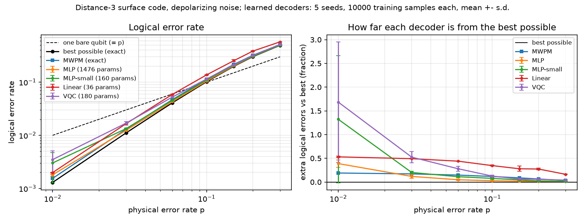

# qec-vqc-decoder

Decoding the distance-3 surface code with a VQC, an MLP, MWPM and the optimal (maximum-likelihood) decoder. Depolarizing noise on the data qubits, perfect syndrome measurement.



Decoding is treated as classification, as in Varsamopoulos et al. (2017): a fixed correction clears the 8-bit syndrome, and the decoder predicts which logical (I, X, Z, Y) is left. Error rates are exact: each decoder is a lookup over the 256 syndromes, and P(syndrome, class) comes from enumerating all 4^9 = 262,144 errors (checked against 10^6-sample Monte Carlo). Learned decoders are trained on 10,000 samples at each p, 5 seeds.

| p | optimal | MWPM | MLP | MLP-small | linear | VQC |
|---|---|---|---|---|---|---|
| 0.01 | 0.0013 | 0.0015 | 0.0018 ± 0.0001 | 0.0030 ± 0.0017 | 0.0020 ± 0.0000 | 0.0035 ± 0.0017 |
| 0.03 | 0.0111 | 0.0130 | 0.0124 ± 0.0004 | 0.0133 ± 0.0003 | 0.0166 ± 0.0001 | 0.0169 ± 0.0013 |
| 0.06 | 0.0410 | 0.0470 | 0.0430 ± 0.0006 | 0.0456 ± 0.0009 | 0.0590 ± 0.0002 | 0.0525 ± 0.0021 |
| 0.10 | 0.1019 | 0.1138 | 0.1046 ± 0.0006 | 0.1097 ± 0.0019 | 0.1371 ± 0.0011 | 0.1146 ± 0.0018 |
| 0.15 | 0.1980 | 0.2154 | 0.2012 ± 0.0008 | 0.2068 ± 0.0039 | 0.2533 ± 0.0110 | 0.2106 ± 0.0045 |
| 0.20 | 0.3020 | 0.3215 | 0.3066 ± 0.0015 | 0.3088 ± 0.0019 | 0.3848 ± 0.0061 | 0.3190 ± 0.0044 |
| 0.30 | 0.4934 | 0.5089 | 0.4995 ± 0.0010 | 0.5006 ± 0.0013 | 0.5737 ± 0.0020 | 0.5132 ± 0.0041 |

MLP: 8-32-32-4 (1,476 params). MLP-small: 8-12-4 (160). VQC: 8 qubits, 6 layers of Rot + CNOT ring, <Z> on each qubit into a linear layer (180).

Notes
- MWPM is 3-19% above optimal because it decodes X and Z separately, so Y errors cost double (known; see Varsamopoulos et al.). The MLP gets back 60-80% of that gap for p >= 0.06.
- The VQC is about level with MWPM for p >= 0.1 and worse below. It beats the linear model but loses to MLP-small, which has a similar parameter count, at every p.
- Reading the 4 classes straight from 2 qubits' probabilities doesn't work: summed over all 256 inputs, every class gets exactly 64, but the optimal decoder answers I on 161 syndromes. <Z> on every qubit plus a linear layer fixed this.
- At p = 0.01, 10,000 samples aren't enough for any learned decoder; rare syndromes show up only a few dozen times.

Next steps
- Measurement noise and repeated syndrome rounds (phenomenological, then circuit-level with stim).
- Distance 5 and up, where enumeration is too big and evaluation needs Monte Carlo.
- A stronger baseline: correlated matching in PyMatching, which accounts for Y errors.
- The VQC under its own gate and shot noise, trained with the parameter-shift rule.

Run

```
uv run python run.py             # checks + figure from results/learned.json
uv run python run.py --retrain   # retrain all learned decoders (~10 min)
```

`surface_code.py` has the code, syndromes and exact probabilities, `decoders.py` the decoders, `run.py` the checks, sweep and figure.

References: Varsamopoulos, Criger, Bertels, arXiv:1705.00857 · Torlai, Melko, arXiv:1610.04238 · PyMatching (Higgott, Gidney)
